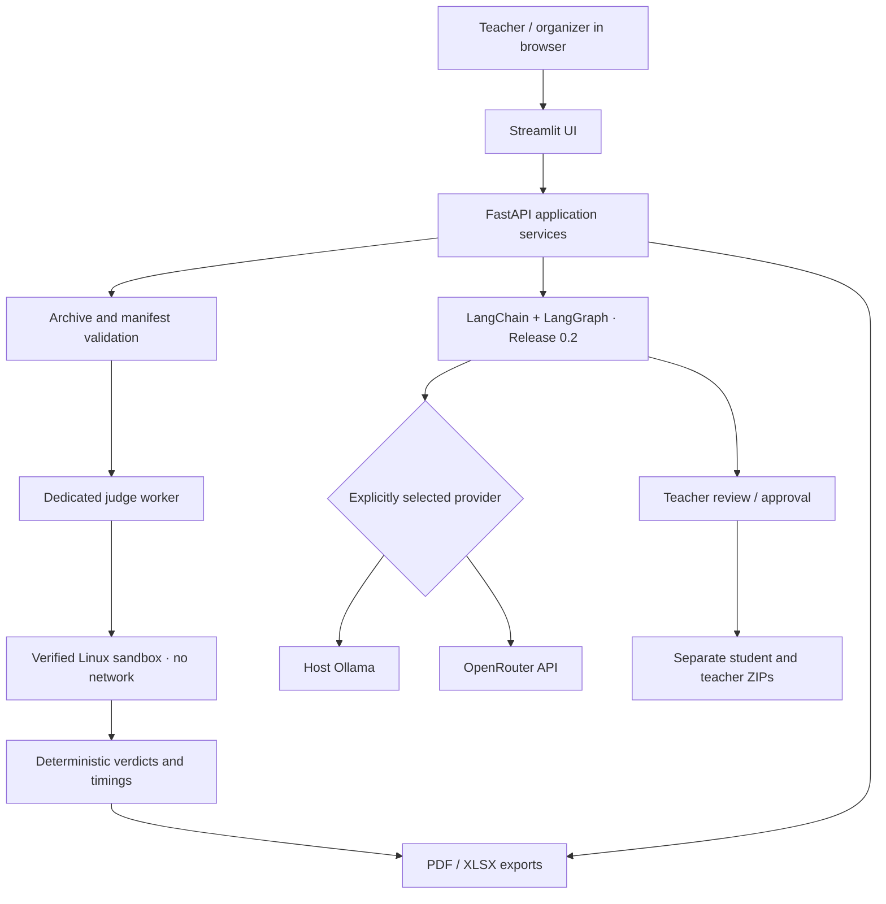
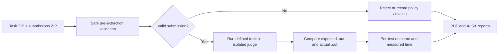

# ContestCheck AI

> **Create programming challenges, evaluate anonymous submissions, and review objective results.**

[](LICENSE)


**ContestCheck AI** is a self-hosted **AI-assisted programming challenge generator and automated code judge** in development for teachers, programming competitions and independent practice. A teacher will be able to upload an anonymous submissions archive, check solutions against defined file-based tests, inspect per-test outcomes and runtimes, and download PDF/XLSX reports. An optional LangChain/LangGraph authoring workflow will later draft problem statements, examples, starter code and private test cases for teacher approval.

> **Current state: CCA-001 archive-validation foundation.** The local Streamlit UI and FastAPI API validate task/submission ZIPs with a strict manifest and private temporary extraction. **Program execution is hard-disabled.** Release 0.1 is in progress; judging, verdicts, reports, Docker deployment and Release 0.2 AI authoring remain planned. The diagrams below describe the target system. See [local setup](docs/local-development.md) and [verification evidence](docs/releases/release-0.1-automated-judge/verification.md).

## What will users do?

**Judge mode (Release 0.1)**

1. Upload a teacher-owned **task package** (`task-config.json` + private test input/output files).
2. Upload a **submissions ZIP** containing anonymous numeric participant folders and Python solutions (one or more supported `.py` files per submission).
3. Validate archives before extraction; use an isolated offline judge worker for verified sandbox execution.
4. See per-participant and per-test **Accepted / Wrong Answer / Runtime Error / Time Limit / Memory Limit** results with measured runtimes. Invalid/policy-violating submissions and review flags have separate reasons.
5. Download the results as **XLSX** and **PDF**. **No numeric scoring or leaderboard** in the initial release.

**Challenge authoring (Release 0.2)**

1. Describe the algorithmic challenge in plain language and choose a configured Ollama or OpenRouter model.
2. A bounded LangGraph workflow drafts a challenge specification, sample inputs/outputs, starter Python file, reference solution and private tests.
3. The system attempts validation using the **same proven judge sandbox** and shows warnings and limitations to the teacher.
4. The teacher can **approve, revise or reject** before exporting: (a) a **student ZIP** with `problem.pdf`, sample `.in`/`.out` and starter source; (b) a separate **teacher ZIP** with private tests and reference material.

These are **two complementary workflows**, not a student account portal or automatic grading by a language model.

## Planned architecture



The judge worker does not receive OpenRouter credentials, internet access, or permission to access unrelated files. The web/API processes must **never execute uploaded source**. An ordinary Docker container by itself is not considered a verified secure sandbox. Review the [architecture](docs/architecture.md) and [sandbox threat model](docs/security-and-sandbox.md).

## Judge workflow — Release 0.1



The initial checker uses a documented text comparison rule for file-based I/O. Results describe **observed runtime under stated limits**; they do not prove theoretical algorithm complexity. Test passing does not imply the software is safe or cheat-proof.

## Intended technology stack

| Layer | Technology / purpose |
| --- | --- |
| Language & packaging | **Python 3.12**, `uv` or equivalent pinned dependencies |
| Frontend | **Streamlit** — uploads, model selection, tables, review and downloads |
| Backend | **FastAPI** + **Pydantic** for validation/orchestration |
| AI authoring (0.2) | **LangChain**, **LangGraph**, Tool Calling, Human-in-the-Loop |
| Model providers (0.2) | **Ollama** locally, **OpenRouter** optionally; up to 3 configured models each |
| Code execution (0.1) | Separate **offline sandboxed Linux judge** (NsJail candidate; subject to validation) |
| Initial solution language | **Python**; C, C++ and Free Pascal considered later |
| Documents & exports | **ReportLab** PDF, **openpyxl** XLSX, standard ZIP archives |
| Tests | **pytest**, isolated security/runner integration checks |
| Deployment | **Docker Compose**, with web/API/worker separation and no public judge endpoint |
| Database | **None for MVP** — bounded temporary workspaces; optional small local checkpoint persistence later |

CCA-001 pins the Python web/validation dependencies in `pyproject.toml` and `uv.lock`; see the [dependency license inventory](docs/dependency-licenses.md). Sandbox host requirements and actual Docker commands remain future work.

## Proposed archive contracts

**Teacher task package** (input to the Release 0.1 judge):

```text
task-package.zip
└── challenge/
    ├── task-config.json
    └── tests/
        ├── 01.in
        ├── 01.out
        ├── 02.in
        └── 02.out
```

**Student submissions** (numeric folder names are opaque identifiers; no real names):

```text
submissions.zip
├── 1001/
│   ├── main.py
│   └── helper.py
├── 1002/
│   └── main.py
└── 1003/
    └── main.py
```

A task manifest defines the entry filename, input/output filenames and test limits. The runnable code may have supporting same-folder source files, but may not read arbitrary paths or create unexpected outputs. The task and submission archive structure is documented in [Archive contracts](docs/archive-contracts.md).

**Challenge authoring will produce two different archives:** a student ZIP with `problem.pdf`, starter file, example `.in`/`.out` and a teacher ZIP with hidden tests and reference solution. Hidden expected outputs must never appear in the student ZIP.

## Results and review

- **Per test:** verdict (`AC`, `WA`, `TLE`, `MLE`, `RE`, etc.), elapsed time, optional memory figures if reliably available, and sanitized diagnostic summary.
- **Per participant:** opaque ID, supported language, run/test summary, and links to downloadable PDF/XLSX result reports.
- **Disqualified / rejected:** only clear archive/policy violations, with exact rules and recorded reasons. Suspicious behavior alone is **flagged for human review** instead of automatically disqualifying anyone.
- **No numeric score:** no points, ranking or plagiarism verdicts in Release 0.1.

Read [Verification and verdicts](docs/verdicts-and-reporting.md) for limitations and formats.

## Model configuration — Release 0.2

Six optional `.env` slots, selected explicitly:

```dotenv
OLLAMA_BASE_URL=http://host.docker.internal:11434
OLLAMA_MODEL_1=
OLLAMA_MODEL_2=
OLLAMA_MODEL_3=

OPENROUTER_API_KEY=
OPENROUTER_MODEL_1=
OPENROUTER_MODEL_2=
OPENROUTER_MODEL_3=
```

Empty model slots do not appear in the UI. Cloud calls require configured server-side credentials and explicit user selection; no surprise fallback or unbounded loop. **Only selected prompts and draft materials** are sent to the chosen LLM. Student submissions are not automatically uploaded to an LLM. Refer to [Model configuration](docs/model-configuration.md).

## Local setup — archive validation only

Install dependencies, then start the API and UI in separate terminals from the repository root:

```bash
uv sync --locked
uv run --frozen uvicorn contest_check.api:app --host 127.0.0.1 --port 8000 --limit-concurrency 4
# In another terminal:
uv run --frozen streamlit run streamlit_app.py --server.port 8501
```

Open <http://127.0.0.1:8501>. Use `uv run --frozen python scripts/make_demo_archives.py` to create inert upload fixtures in `.runtime/demo/`. The [development guide](docs/local-development.md) documents repeatable tests, API responses and the future Docker service layout. No Compose file or sandbox is supplied. `.env` cannot enable execution. This is a local single-operator application; public deployment remains out of scope.

## Roadmap, stories and verification

| Document | Purpose |
| --- | --- |
| [Roadmap](docs/roadmap.md) | Release scope and ordering |
| [Release 0.1 – Automated Judge](docs/releases/release-0.1-automated-judge/README.md) | Four Python judge/reporting stories |
| [Release 0.2 – AI Challenge Authoring](docs/releases/release-0.2-ai-challenge-authoring/README.md) | Four LangChain/LangGraph authoring stories |
| [Release 0.1 verification](docs/releases/release-0.1-automated-judge/verification.md) | CCA-001 evidence; later stories `Not run` |
| [Release 0.2 verification](docs/releases/release-0.2-ai-challenge-authoring/verification.md) | Currently `Not run` |
| [Architecture](docs/architecture.md) | UI, orchestration, worker, agents and diagrams |
| [Archive contracts](docs/archive-contracts.md) | Task/submission/student/teacher ZIP schemas |
| [Security and sandbox](docs/security-and-sandbox.md) | Critical execution safeguards and fail-closed gates |
| [Verdicts and reporting](docs/verdicts-and-reporting.md) | Per-test metrics, output comparison, PDF/XLSX exports |
| [Model configuration](docs/model-configuration.md) | Provider allowlists and billable call safety |
| [Testing](docs/testing.md) | Mock checks, sandbox integration, release evidence |
| [Codex roles and skills](.codex/README.md) | Minimal agent setup and technology-specific skills |
| [Story workflow](docs/story-workflow.md) | Separate implementation/commit approval |
| [Future ideas](docs/future.md) | Languages, scoring and features not yet committed |

See [AGENTS.md](AGENTS.md) for the repository's mandatory workflow and source-license convention. Only CCA-001 is implemented; subsequent stories require separate implementation approval.

## License

Apache-2.0. Copyright © 2026 **Keresztes Zsolt** — [kereszteszsolt.hu](https://kereszteszsolt.hu).

New hand-written application source uses the short, two-line SPDX notice described in [AGENTS.md](AGENTS.md). Generic or generated configuration files do **not** receive source license headers. See the full [LICENSE](LICENSE). Review dependencies and sandbox runtime licensing independently.

## Contact

**Project maintainer: Keresztes Zsolt**

| Platform | Link |
| --- | --- |
| Website | [kereszteszsolt.hu](https://kereszteszsolt.hu/) |
| GitHub | [@kereszteszsolt](https://github.com/kereszteszsolt) |

> The maintainer's website is available in Hungarian (HU), English (EN), Romanian (RO) and German (DE).

## ☕ Ways to support

**Explore ways to support the maintainer and their projects.**

[https://kereszteszsolt.hu/ways-to-support](https://kereszteszsolt.hu/ways-to-support)

<p align="center">
  <a href="https://buymeacoffee.com/kereszteszsolt"></a><br>
  <strong>Every coffee counts! ☕❤️</strong>
</p>

---

<p align="center">
  <strong>Made with ❤️ by <a href="https://kereszteszsolt.hu/">Keresztes Zsolt</a></strong><br>
  ⭐ Star this repository if you find it useful!
</p>
