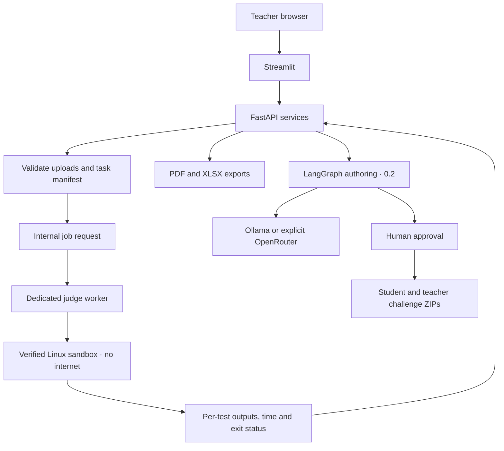
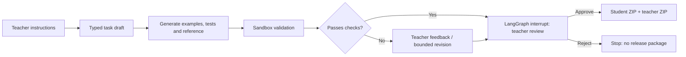

# Architecture — planned design

## System boundary

The UI and API coordinate business operations; **neither may compile or execute student submissions**. The judge worker is internal-only, has no secrets or outward internet access, and uses a verified jail for every compile/run step. Docker Compose packaging is only a deployment convenience, not sufficient proof of hostile code isolation.

## Services, proposed

| Component | Responsibility | Boundary |
| --- | --- | --- |
| Streamlit UI | Upload files, choose task/model, show verdicts, approve drafts, downloads | No execution privilege, no model key in browser |
| FastAPI | Validate and orchestrate jobs; report export; bounded LangGraph invocation | No direct `subprocess` for student code |
| Judge worker | Accept validated internal work orders; launch sandbox with limits | Internal API only; no egress, secrets or Docker socket |
| Sandbox | Compile/run per participant/test with approved input and output paths | Isolated OS/file/network/process resources |
| LangGraph (0.2) | Bounded draft → validate reference → interrupt → approval → package | No access to unbounded tools/files/network |
| Ollama/OpenRouter (0.2) | Explicitly selected text generation | Ollama host or approved OpenRouter endpoint only |

## Temporary data and state

- One private, randomly named workspace per operation with a fixed TTL and cleanup on success/error.
- Opaque participant identifiers; no user accounts, student names or permanent submission database.
- LangGraph in-memory checkpointer can support approval in one process for demo; if restart-safe HITL is required, adopt an explicitly scoped local SQLite checkpoint store without creating a full account database.
- UI previews and report downloads are generated only from validated results; no untrusted HTML/macros/external assets.

## High-level AI authoring flow (Release 0.2)

Every generated challenge is a **draft** until teacher approval. Test-case agreement with an AI-generated reference solution is useful evidence, **not a correctness guarantee**.

## Explicit non-goals

No GitHub scraping, arbitrary external service integrations, RAG, runtime MCP server, full multi-agent team, scoring, student login, plagiarism oracle, production Internet-facing judge or automatic release publication in these two planned releases.
