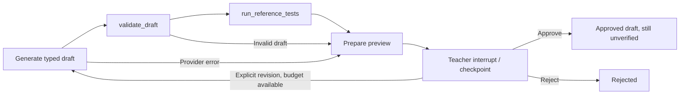

# Bounded authoring workflow — CCA-006

CCA-006 adds a **teacher-only backend** LangGraph workflow alongside the existing one-call CCA-005 preview. It uses the same [configured models](model-configuration.md), strict `TaskDraft` schema and qualified offline worker. The Streamlit workflow/review UI and independent correctness review are still planned. CCA-007 adds separate [approved student/teacher exports](challenge-packages.md) through the backend API. No live model or generated-reference execution was verified for this story; see [release evidence](releases/release-0.2-ai-challenge-authoring/verification.md).

## Flow and trust boundary



The workflow accepts teacher instructions, topic, difficulty and an explicitly selected backend model slot. The model cannot select tools, extend budgets, fetch URLs or name a checkpoint/host path. Only the fixed `validate_draft` and `run_reference_tests` nodes are allowed. LangChain model requests still have no tools/plugins, fallback, retries, browsing or tracing. Instructions, prior drafts, revision text and generated source are untrusted data. File-I/O basenames, `main.py`, resource bounds and structured output are validated again before any worker call, including constructed/mutated Pydantic objects.

State records the current draft, safe errors with attempt numbers, warnings, cumulative model/tool/worker counts, per-attempt tool results, approval and minimal review events (`attempt`, `action`). No prompt/source/exception-body logging is added. A revision sends the original instructions plus bounded topic/difficulty, up to 2,000 revision characters and the previous validated draft to the **same** selected provider/model. Teacher-private content stays in this teacher workflow; no contestant submissions enter the model context.

## Local API

Run one native API process as described in [local development](local-development.md). These endpoints have no account/authentication system and are intended for the existing local teacher/operator setup. Workflow IDs are random 128-bit private capabilities; keep them private. There is no workflow-list endpoint or public/student preview. Do not expose this local API as a public service.

| Endpoint | Behavior |
| --- | --- |
| `POST /api/authoring/workflows` | Create one workflow, generate/check once and return at the teacher interrupt |
| `GET /api/authoring/workflows/{workflow_id}` | Read the current preview without another model/tool call |
| `POST /api/authoring/workflows/{workflow_id}/review` | Resume the current interrupt with an explicit decision |
| `DELETE /api/authoring/workflows/{workflow_id}` | Delete its checkpoint and release local capacity; 204 on success |

Create request (only the reference-check opt-in is optional):

```json
{
  "model_slot": "ollama:1",
  "instructions": "Draft a Python file-I/O addition exercise with clear integer bounds.",
  "topic": "Integer arithmetic",
  "difficulty": "beginner",
  "run_reference_tests": false
}
```

`difficulty` is `beginner`, `intermediate` or `advanced`. Instructions require 1–8,000 characters; topic requires 1–120 nonblank characters. The authoring HTTP body remains capped at 64 KiB before parsing. Unknown fields, arbitrary model IDs/endpoints, raw graph commands and checkpoint IDs/paths are refused. No model call happens on an unknown/disabled slot or a full store.

The response is a `WorkflowPreview`: `workflow_id`, `state`, `can_approve`, `can_revise`. At a pause, `state.status` is `awaiting_review` and `state.review_id` identifies that exact preview. `state.draft` includes teacher-private source/tests. Provider timeout/invalid output becomes a safe `state.errors` entry and a reviewable pause with no draft; it does not trigger automatic repair/retry. Approval is blocked without a valid draft. A provider-error pause therefore returns HTTP 200 with explicit error state; the older one-call draft endpoint retains its existing HTTP error behavior.

Review request:

```json
{
  "review_id": "<32 lowercase hexadecimal characters from state.review_id>",
  "action": "revise",
  "revision": "Explain negative integers and their bounds."
}
```

`action` is `approve`, `revise` or `reject`. Only `revise` requires nonblank `revision`; approval/rejection accept only absent/empty revision text. A revision consumes another generation attempt and returns a **new** review ID. Approval/rejection ends the graph and clears the ID. Old, repeated, cross-workflow or terminal review decisions return 409 `stale_review` without repeating effects. Exhausted revision budgets return 409 `revision_budget`; invalid approval returns 409 `approval_blocked`. Unknown/expired workflows return 404. Running/full workflows return safe 503 errors. Successful previews/decisions/deletion and workflow error responses use `Cache-Control: no-store`.

Approval acknowledges the reviewable draft, including any visible mismatch, skipped checks or uncertainty; **it does not establish correctness, independently verify tests, accept official contest tests or publish anything**. `verification` remains `unverified` after approval. CCA-007 allows the approved materials to be downloaded as separate student/teacher packages with this explicit status. Final independent teacher verification and the polished UI remain CCA-008 scope.

## Reference checking

Reference checking requires both `run_reference_tests: true` and the existing explicit operator settings `JUDGE_EXECUTION_ENABLED=true` / `JUDGE_REVIEWED_PROFILE=true`. These settings select the fixed `DockerWorker` transport; they do not establish qualification. Each worker still qualifies its real sandbox in its own process before running a candidate. Missing configuration returns `blocked / execution_disabled`; failed qualification, malformed worker response or cleanup/infrastructure uncertainty returns `blocked / sandbox_failure` and stops further tests in that check. No host/Python subprocess fallback is added. The [worker protocol and deployment boundary](judge-worker.md) are unchanged.

The candidate reference is sent as the single `main.py` source, together with one declared input and resource limits. Expected outputs stay in the coordinator. Public examples run first, then private tests in draft order. Each case records its group, test ID, existing verdict/reason and measured wall time when available. Successful capture includes up to 2,048 bytes of observed output, UTF-8 decoded with replacement and an explicit truncation flag; comparison uses the complete captured bytes and the existing `exact` / `tokens` rules. Mismatches are reported as observed `WA`; timeout as `TLE`. Memory/output/exit hints retain the existing ambiguous `RE` reasons, without invented memory measurements or DQ.

No opt-in produces `skipped / not_requested`, with all cases counted as not run. The cumulative worker-run cap produces `partial` or `skipped / run_budget`, with exact not-run counts; it never silently claims full coverage. A passing candidate against generated examples/tests remains **unverified** because the same model may have made consistent mistakes in both. Reference results never change official contest verdicts, and failures never initiate autonomous regeneration.

## Budgets, checkpointing and cleanup

| Boundary | Limit |
| --- | --- |
| Generation attempts | At most 3, each subsequent attempt requires explicit teacher revision |
| Model calls | Shared configured `AI_MAX_CALLS_PER_GENERATION` (1–6); the lower available attempt/model budget wins; failures count when an outbound attempt occurs |
| Tool invocations | At most 6 across all revisions: validation + reference-check tool per valid attempt |
| Worker invocations | At most 20 public/private cases **across the whole workflow**, including failures |
| Individual worker deadline | Existing 45-second transport bound, including startup qualification/cleanup; no automatic retry |
| Model deadline/output | Existing 1–120 second absolute call deadline, 256–8,192 tokens, 256 KiB wire response, 128 KiB validated draft |
| Local workflows | At most 8, each expires 3,600 seconds after creation; expired idle entries are pruned on the next store operation |

The actual LangGraph graph uses Pydantic state, `interrupt(..., response_schema=ReviewRequest)`, `Command(resume=...)` and an `InMemorySaver` with synchronous checkpoint durability during each invocation. Pickle fallback and arbitrary MessagePack class restoration are disabled. Checkpoints contain application JSON and LangGraph's safe built-in types, never backend model settings/API keys. Tracing is disabled around the whole graph, including inherited tracing settings.

Only the review node restarts on ordinary resume; model/worker effects occur in earlier nodes. The service also validates the current review ID before invoking the graph, serializes modifications, and retains the model/worker call ledger across revisions. Unexpected graph/checkpoint failure invalidates the session and prevents automatic replay of uncertain effects. There is no raw `Command`, time-travel/replay API or client state update route.

Checkpoints and call ledgers exist **only in the current API process**; restart loses them. This is not durable crash recovery or a distributed queue. Approval/rejection retains a preview until deletion/expiry; deletion/expiry removes all associated checkpoint storage/writes/blobs. Explicit deletion is blocked while generation/review is running. Shared authoring/judge admission slots prevent concurrent model work and concurrent regular judging/reference checks. The current Streamlit page still uses the CCA-005 one-call preview; no new UI behavior is claimed.

Pinned implementation references: [LangGraph interrupts](https://docs.langchain.com/oss/python/langgraph/interrupts), [graph API](https://docs.langchain.com/oss/python/langgraph/graph-api), plus installed LangGraph 1.2.16 / checkpoint 4.3.0 source. Mocked API and actual graph/checkpoint tests exercise approval/revision/rejection; a live teacher/model/sandbox session is **Not run**.
